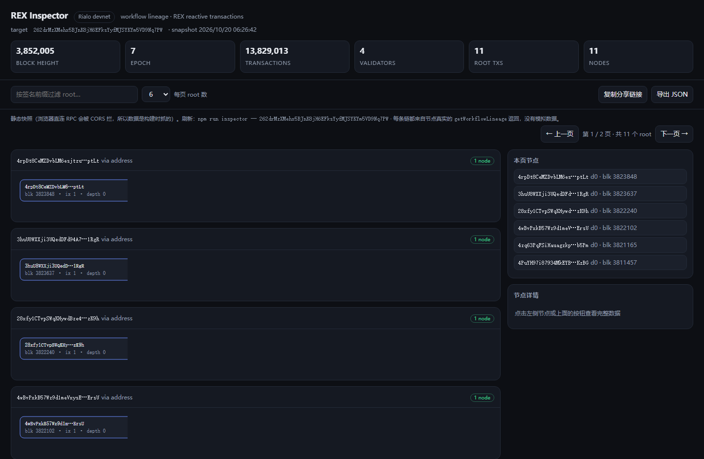

# rialo-devnet

Working notes and runnable code for the **Rialo devnet** (Subzero Labs L1) — verified
against the live network, not copy-pasted from docs.

Everything here was executed with `@rialo/ts-cdk` 0.18.1 against `https://devnet.rialo.io:4101`.

## What is verified

`demo.mjs` runs the full client write path and asserts on the results:

```
connected   — blockHeight=3805883, epoch=7
airdrop     — 5bzVV9cFMkVmFzu2xD4hRyUt9CSgP4vJnAZx49kXcVzjzKQAHH7WBnjeVPXgQwcqmfdTeWGw245MS8T5oripXg9x
transfer    — 3k52FAsLEdYFUfmw6Wvs3dcjXVQZD3T983186FbsKotNB5VKKL6GypmqrPzC91LhNFfEvi3x6FqKYtCTBYqxkcUR
balances    — payer 0.8 → 0.7 RLO, recipient +0.1 RLO
assertions  — 5/5 passed
```

Run it yourself:

```bash
npm install
npm test                       # = node demo.mjs
```

First run creates `devnet-wallet.json` (a throwaway devnet wallet) and requests 1 RLO from
the faucet; later runs reuse it. **Never fund that wallet on mainnet.**

## Devnet facts (measured, 2026-10-20)

| Thing | Value |
| --- | --- |
| RPC | `https://devnet.rialo.io` (443 works; the SDK preset uses `:4101`) |
| Health | `getHealth` → `ok`; `getVersion` → `d838f11dc607…` |
| Faucet cap | **1 RLO per request** (`requestAirdrop` above that is rejected) |
| Units | 1 RLO = 1 000 000 000 kelvin |
| Derivation | BIP44 coin type **756**, path `m/44'/756'/{index}'/0'` |
| No `getSlot` | use `getBlockHeight` / `getEpochInfo` instead |
| State settling | balances can lag a fraction of a second behind `sendAndConfirmTransaction` — **poll**, don't trust one read (measured ~200–250 ms here; a single-shot read did fail once) |
| RPC surface | standard transfer/balance/account/getTransaction + Rialo extras: `getWorkflowLineage`, `getTriggeredTransactions`, `getDkgStatus`, `getSecretSharingPubkey`, `getValidatorAccounts` |
| Program deploy | `ProgramDeployment` ships **PolkaVM** binaries in chunks (SDK supports it; not yet exercised here) |

## Code

```
demo.mjs         mnemonic → keypair → airdrop → transfer → live assertions
deploy-probe.mjs attempts ProgramDeployment of a .polkavm blob (see caveat below)
playbook.md      notes on Rialo's Agent Grand Prix (AGP): economics, MCP, strategy
```

`deploy-probe.mjs` is a probe, not a working deploy: it uploads whatever blob you give it
through the SDK's `ProgramDeployment` and prints the node's actual answer. The blob it ships
with today is a 30-byte empty program, because producing a valid one needs Rialo's private
`rialo-rust` toolchain (target `riscv64emac-solana-solana`) — see below.

## REX Inspector (workflow lineage)

**Live: https://seve789.github.io/rialo-devnet/**

`getWorkflowLineage` is one of the RPCs that makes Rialo different from a plain SVM chain:
it returns the DAG of transactions related through REX subscriptions. The Inspector turns
that into something you can actually look at.

```bash
npm run inspector -- <signature-or-address> [--out index.html] [--limit 24]
npm run test:ui        # 15 jsdom assertions: pagination, filtering, node detail, data shape
```

Features: live devnet status strip (block height / epoch / transactions / validators),
root pagination with search, per-node detail panel (humanised timestamp, program ids,
subscriptions, children, raw JSON), `?node=<sig>` deep links, JSON export.

**Devnet sends no `Access-Control-Allow-Origin`** (checked against `localhost`,
`playground.rialo.io` and `null`), so the browser cannot call the RPC directly — the page is
a build-time snapshot with the data embedded, and states its snapshot time in the header.
Regenerate it with the command above; no server or proxy is involved.

Current snapshot: `roots=11 nodes=11 subscriptions=0`, devnet `validators=4`.

**`subscriptions=0` is the honest state**: a subscription edge appears only when a program
emits an event that triggers another transaction, and deploying a program is gated behind
Rialo's private toolchain (see below). The renderer consumes the node's real
`workflowNodes / workflowChildren / subscriptions` shape and draws those edges as soon as
they exist — nothing is mocked.



## Not yet verified

- Deploying a program: the SDK exposes `ProgramDeployment` (PolkaVM chunks), and the program
  toolchain exists on crates.io (`rialo-syngen-dsl`, `rialo-build-lib`), but a build has to
  produce a `.polkavm` binary first. Not done here — no claim is made that it works.
- AGP racing: the client SDK is unrelated to AGP; AGP is an MCP endpoint. See `playbook.md`.

## 中文说明

Rialo devnet 的实测笔记 + 可运行代码。`demo.mjs` 跑通"助记词 → 空投 → 转账 → 断言校验"
全链路，交易签名可以到链上核对。devnet 的水龙头单次上限 1 RLO，单位是 kelvin（1 RLO =
10⁹ kelvin），派生路径 BIP44 coin type 756。

**未验证的部分**：合约部署（SDK 有 `ProgramDeployment`，但需要先编译出 `.polkavm` 二进制，
本仓库没有做，因此不作任何承诺）；AGP 参赛（走 MCP，见 `playbook.md`）。

## License

MIT
